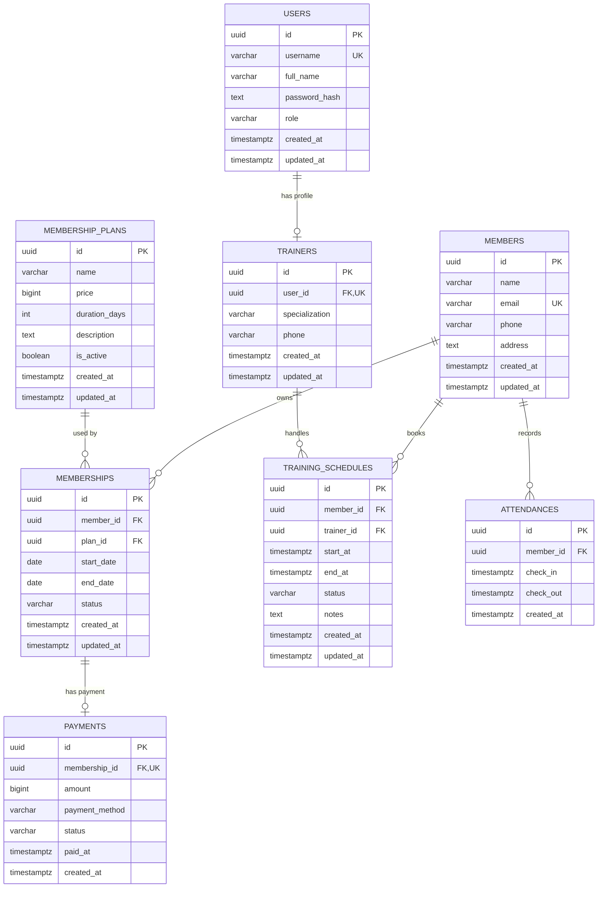

# Gym Management System — Entity Relationship Diagram

## Database Overview

Database ini menggunakan PostgreSQL dan terdiri dari 8 tabel utama:

1. users
2. trainers
3. members
4. membership_plans
5. memberships
6. payments
7. training_schedules
8. attendances

## Entity Relationship Diagram

## Relationship Description

| Parent Table | Child Table | Relationship |
|---|---|---|
| users | trainers | One-to-zero-or-one |
| members | memberships | One-to-many |
| membership_plans | memberships | One-to-many |
| memberships | payments | One-to-zero-or-one |
| members | training_schedules | One-to-many |
| trainers | training_schedules | One-to-many |
| members | attendances | One-to-many |

## Important Database Rules

- A trainer account is stored in `users` and has a corresponding record in `trainers`.
- A membership belongs to one member and uses one membership plan.
- Each membership can have at most one payment record.
- A training schedule belongs to one member and one trainer.
- An attendance record belongs to one member.
- Passwords are stored as bcrypt hashes, never as plain text.
- Membership activation after successful payment is handled by the service layer.
- Trainer schedule conflict validation is handled by the service layer.
- Only active members should be allowed to check in, enforced by business logic.

## Notes

This document describes the initial database schema implemented in the `feature/project-setup` branch.

Any schema changes must be coordinated with the project team and reflected in the migration files.
